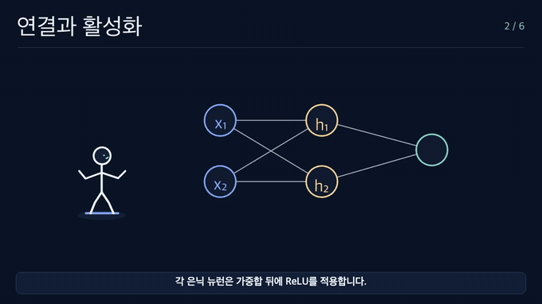
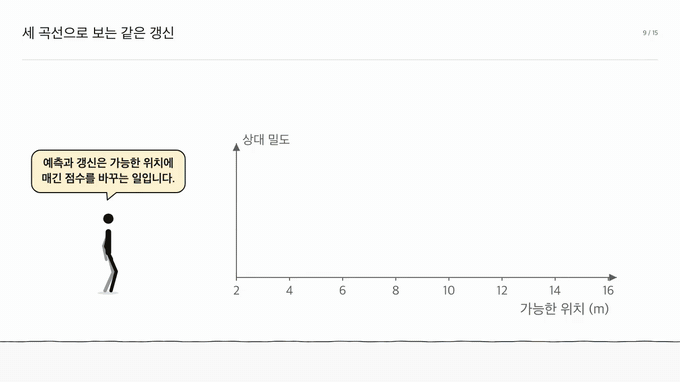

# MathScene

하나의 스토리보드와 장면 JSON으로 한국어 수학 강의 MP4와 조작 가능한 HTML을 만드는 Codex 스킬이다. 영상은 ManimCE, Canvas, FFmpeg로 만든다. 웹은 KaTeX와 SVG를 포함한 정적 파일로 생성된다.

## 영상 미리보기

| MLP의 입력층·은닉층·출력층 | 칼만 필터의 분포 갱신 |
| --- | --- |
|  |  |
| [6초 MP4](media/mlp-forward.mp4) | [10초 MP4](media/kalman-update.mp4) |

Codex에서 `$mathscene ReLU가 있는 MLP의 순전파를 한국어로 설명하고 웹과 영상으로 만들어줘`처럼 요청한다. 스킬이 학습 순서를 정리하고, 수식·도형·캐릭터가 등장하는 시점을 한 장면 파일에 기록한 뒤 두 형식으로 렌더링한다. 웹에서 입력을 움직이면 은닉층과 출력값이 즉시 바뀐다.

## 시작하기

macOS에서는 Node, FFmpeg, Cairo, Pango, pkg-config를 설치한다. 아래 명령은 프로젝트 루트에서 실행한다.

```bash
brew install node ffmpeg cairo pango pkg-config
python3 -m venv .venv
source .venv/bin/activate
python -m pip install -e '.[video,test]'
npm ci
npm run browser:install
mathscene doctor --video
```

Ubuntu 계열 Linux에서는 Python 3.11 이상과 Node.js 22.12 이상을 준비하고 아래 패키지를 설치한다. 이후 같은 가상 환경 및 npm 설치 명령을 사용한다. 시스템 라이브러리가 빠져 있다면 npm 설치 후 `npx playwright install --with-deps chromium`으로 브라우저 의존성을 설치한다.

```bash
sudo apt install python3-venv python3-dev build-essential pkg-config libcairo2-dev libpango1.0-dev ffmpeg fonts-noto-cjk
```

웹 전용 사용자는 `python -m pip install -e '.[test]'`과 `mathscene doctor`를 사용한다. 영상과 웹 모두 렌더 검증에 Chromium을 사용한다. LaTeX 배포판은 필요 없다.

Codex에서 발견하려면 아래 설치 스크립트로 스킬 하나를 링크한다. 런타임 가상 환경을 활성화한 뒤 Codex에서 `$mathscene`을 호출할 수 있다. 프로젝트 위치가 바뀌면 링크도 갱신한다.

```bash
./scripts/install-skill.sh
```

## MLP 예제

```bash
mathscene validate examples/mlp/scene.json
mathscene render examples/mlp/scene.json --mode both
```

4단계에서는 두 가중합과 ReLU, 출력 계산을 식으로 확인한다. 5단계에서 첫 입력값을 2에서 4로 바꾸면 출력이 3에서 6으로 바뀐다. 각 은닉 뉴런의 활성값과 출력 막대가 함께 갱신된다. 생성된 웹 폴더는 `index.html`을 직접 열거나 로컬 HTTP 서버에서 열 수 있다.

| 데모 | 명령의 모드 | 주제 |
| --- | --- | --- |
| `examples/mlp/scene.json` | `both` | 가중합, ReLU, 순전파 |
| `examples/kalman-filter/scene.json` | `video` | 예측 분포, 관측 우도, 사후 분포 |
| `examples/linear-algebra/scene.json` | `web` | 고유방향, 고유값, 비고유벡터 반례 |
| `examples/rfs-intuition/scene.json` | `both` | 독립 베르누이 객체의 집합 및 개수 분포 |

`./scripts/render-demos.sh`로 전체 데모를 렌더한다. 각각 `output/<예제 이름>/`에 저장된다. 필요하면 `--out /절대/경로`를 사용한다. 다른 작업 디렉터리에서도 입력과 출력의 절대 경로를 넘기면 된다. 일반 설치에서 Node 모듈 위치를 찾지 못하면 npm 설치를 실행한 프로젝트 경로를 `MATHSCENE_NODE_HOME`에 설정한다.

- `web/index.html`과 그 폴더의 정적 에셋을 함께 공유한다.
- `lesson.mp4`는 한국어 자막을 포함한다. `captions.srt`도 함께 제공된다. `--audio /경로/음원`으로 로컬 오디오를 추가할 수 있다.
- `storyboard.md`, `scene.json`, `preview.png`, `validation.json`은 결과 확인에 사용한다. `both`는 웹 화면도 `web-preview.png`에 저장한다.
- `_work/run-*/`에는 렌더 로그, 중간 레이어, 장면별 확인용 프레임이 남는다.

## 개발과 검증

```bash
python -m pytest -q
mathscene doctor --video
```

[스킬과 저작 템플릿](skills/mathscene/SKILL.md), [장면 계약](skills/mathscene/references/scene-schema.md), [아키텍처](docs/ARCHITECTURE.md), [문제 해결](docs/TROUBLESHOOTING.md), [실행 결과와 남은 범위](docs/IMPLEMENTATION_STATUS.md), [소스 조사](docs/SOURCE_ANALYSIS.md), [라이선스](LICENSES.md)를 참고한다.

영상은 슬라이더 기본값을 사용하고, 웹은 값을 바꿀 때 수치와 도형을 다시 그린다. 수식과 도형의 교체 시점은 공통이지만 렌더링 엔진과 글꼴에 따라 세부 표현은 다를 수 있다. 자동 검증 범위는 선언한 기호와 수학 표본, 지원 연산, 지정한 시점의 화면과 동작이다. 내용의 교육적 정확성은 스토리보드와 출력도 함께 검토한다.
