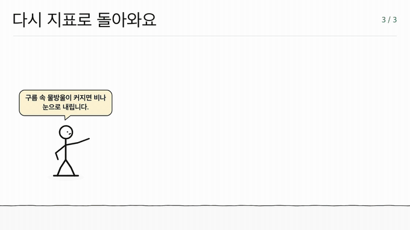

# 스틱맨렉처

도형을 그리고 화살표로 연결하면서 개념이나 과정을 설명하는 Codex 스킬이다. 설명자는 각 요소가 등장하는 순간 말풍선으로 역할과 다음 단계를 알려 준다. 원본 Stick의 흰 종이, 옅은 바닥, 가는 지면선을 참고했다. 하나의 장면 파일로 MP4와 조작 가능한 HTML을 만들 수 있다.

## 영상 미리보기

| 물의 순환 | MLP의 연결과 가중치 | 칼만 필터의 분포 갱신 |
| --- | --- | --- |
|  |  |  |
| [18초 MP4](media/water-cycle.mp4) | [26초 MP4](media/mlp-forward.mp4) | [12초 MP4](media/kalman-update.mp4) |

Codex에서 `$stickman-lecture 물의 순환을 도형과 화살표로 자세히 설명하는 영상 만들어줘`처럼 요청한다. 원·타원·사각형·다각형은 윤곽부터 긋고, 화살표는 시작점에서 도착점으로 그린다. 선과 그래프도 경로를 따라 순차적으로 드러낼 수 있다. 평소에는 요소가 무엇인지, 왜 필요한지, 다음 요소와 어떻게 이어지는지 차례대로 설명한다. 짧은 버전이 필요하면 요청에 길이 또는 간단히라는 조건을 넣는다.

## 설치

macOS에서는 프로젝트 루트에서 아래 명령을 실행한다. 프로젝트 가상 환경을 활성화한 채 Codex를 시작하면 `$stickman-lecture`을 호출할 수 있다.

```bash
brew install node ffmpeg cairo pango pkg-config
python3 -m venv .venv
source .venv/bin/activate
python -m pip install -e '.[video,test]'
npm ci
npm run browser:install
stickman-lecture doctor --video
./scripts/install-skill.sh
```

Ubuntu 계열 Linux에서는 Python 3.11 이상과 Node.js 22.12 이상을 준비하고 아래 패키지를 설치한다. 이후 같은 가상 환경 및 npm 명령을 사용한다. Chromium 시스템 라이브러리가 추가로 필요하면 npm 설치 뒤 `npx playwright install --with-deps chromium`을 실행한다.

```bash
sudo apt install python3-venv python3-dev build-essential pkg-config libcairo2-dev libpango1.0-dev ffmpeg fonts-noto-cjk
```

웹 전용 설치는 `python -m pip install -e '.[test]'`과 `stickman-lecture doctor`를 사용한다. 두 모드의 검증에 Chromium을 사용한다. LaTeX 배포판은 필요 없다.

## 예제 실행

```bash
stickman-lecture validate examples/shapes/scene.json
stickman-lecture render examples/shapes/scene.json --mode both
stickman-lecture render examples/mlp/scene.json --mode both
```

| 데모 | 모드 | 내용 |
| --- | --- | --- |
| [물의 순환](examples/shapes/storyboard.md) | `both` | 태양, 구름, 지표, 하천을 도형과 방향 화살표로 설명 |
| [MLP](examples/mlp/storyboard.md) | `both` | 연결별 가중치, 은닉 뉴런별 계산, ReLU 그래프, 순전파 슬라이더 |
| [칼만 필터](examples/kalman-filter/storyboard.md) | `video` | 한 축에 예측 분포, 관측 우도, 사후 분포를 순서대로 그림 |
| [고유벡터](examples/linear-algebra/storyboard.md) | `web` | 고유방향과 반례를 그린 뒤 슬라이더로 고유값 변경 |
| [RFS와 다중 베르누이](examples/rfs-intuition/storyboard.md) | `both` | 독립 베르누이 객체와 집합 및 개수 확률 설명 |

MLP 웹의 **입력을 직접 바꾸기** 장면에서 첫 입력을 2에서 4로 옮기면 은닉층 막대가 갱신되고 출력이 3에서 6으로 바뀐다.

`./scripts/render-demos.sh`로 전체 예제를 재현할 수 있다. 결과는 `output/<예제 이름>/`에 저장되며 `--out`으로 경로를 바꿀 수 있다. 영상은 슬라이더 기본값으로 렌더링한다. 웹은 폴더 전체를 함께 보관하면 `web/index.html`을 오프라인으로 열 수 있다.

- `lesson.mp4`와 `web/index.html`은 말풍선으로 설명을 보여 준다. `captions.srt`에는 영상 대사가 들어 있다. `--audio`로 준비한 음원을 영상에 추가할 수 있다.
- `storyboard.md`, `scene.json`, `preview.png`, `validation.json`에서 제작 내용과 검증 결과를 확인할 수 있다.
- `_work/run-*/`에는 중간 레이어, 렌더 단계별 로그와 확인용 프레임이 남는다.

## 개발과 검증

```bash
python -m pytest -q
stickman-lecture doctor --video
```

[스킬과 저작 템플릿](skills/stickman-lecture/SKILL.md), [장면 계약](skills/stickman-lecture/references/scene-schema.md), [아키텍처](docs/ARCHITECTURE.md), [문제 해결](docs/TROUBLESHOOTING.md), [실행 결과와 제한](docs/IMPLEMENTATION_STATUS.md), [소스 조사](docs/SOURCE_ANALYSIS.md), [라이선스](LICENSES.md)를 참고한다.
