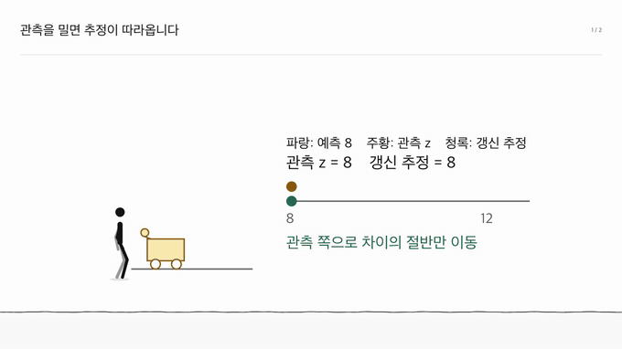

# StickMan Lecture · 졸라맨 강의

졸라맨 강의는 원본 Stick Scene 캐릭터로 개념을 시각화하는 Codex 스킬이다.

| 그래프 그리기 · 칼만 필터의 분포 갱신 | 물체 조작 · 수레와 함께 움직이는 그래프 |
| --- | --- |
|  |  |
| [22초 MP4](media/kalman-update.mp4) | [30.6초 MP4](media/stick-interaction.mp4) |

## 주요 기능

- **캐릭터 조작** · 원본 Stick Scene 캐릭터의 이동, 소품 잡기와 밀기
- **그래프 연동** · 소품의 위치와 그래프 점, 수치의 동기화
- **순차 그리기** · 곡선, 도형 윤곽, 화살표가 그려지는 애니메이션
- **말풍선과 효과음** · 글자 수에 따른 표시 시간 조정, 말풍선과 시각 요소의 등장 효과음
- **나레이션** · 요청 시 말풍선을 한국어·영어 음성으로 읽고 발화 길이에 맞춰 장면 시간을 조정. MP4와 HTML에 적용하며 HTML에서 음소거 가능
- **MP4와 장면 탐색** · 효과음이 포함된 영상, 클릭한 장면으로 이동하는 HTML 플레이어
- **조작 가능한 HTML** · 슬라이더 입력에 따라 움직이는 물체와 그래프, 오프라인 재생

## 설치

Windows, macOS, Ubuntu 계열 Linux에서 Python 3.11–3.13과 Node.js 22.12 이상을 사용한다. 설치 후 Codex에서 `$stickman-lecture`를 호출할 수 있다.

음성 포함 MP4와 HTML 내보내기는 macOS arm64, Windows x64, Ubuntu 24.04 x64에서 Python 3.12로 검증했다. [Windows·Ubuntu 자동 테스트](https://github.com/choimagon/stickman_lecture/actions/workflows/portability.yml)

### macOS

```bash
git clone https://github.com/choimagon/stickman_lecture.git
cd stickman_lecture
brew install python@3.12 node ffmpeg cairo pango pkg-config
python3.12 -m venv .venv
source .venv/bin/activate
python -m pip install -e '.[video,test]'
npm ci
npm run browser:install
stickman-lecture doctor --video
python scripts/install-skill.py
```

### Ubuntu 계열 Linux

Python 3.11–3.13과 Node.js 22.12 이상을 준비하고 다음 패키지를 설치한다. 저장소를 받은 뒤 가상 환경은 설치된 Python으로 만들고 나머지 macOS 명령은 `source`부터 실행한다. Chromium 시스템 라이브러리가 추가로 필요하면 `npx playwright install --with-deps chromium`을 실행한다.

```bash
sudo apt install python3-venv python3-dev build-essential pkg-config libcairo2-dev libpango1.0-dev ffmpeg fonts-noto-cjk
python3 -m venv .venv
```

### Windows PowerShell

Python 3.11–3.13, Node.js 22.12 이상, FFmpeg와 Git을 PowerShell에서 사용할 수 있게 한다. 영상 기능에 필요한 패키지는 [Manim의 Windows 설치 안내](https://docs.manim.community/en/stable/installation/windows.html)에 따라 준비한다.

```powershell
git clone https://github.com/choimagon/stickman_lecture.git
cd stickman_lecture
py -3.12 -m venv .venv
.\.venv\Scripts\python.exe -m pip install -e '.[video,test]'
npm ci
npm run browser:install
.\.venv\Scripts\stickman-lecture.exe doctor --video
.\.venv\Scripts\python.exe scripts/install-skill.py
```

설치된 Python 버전에 맞춰 `py -3.12`를 `py -3.11` 또는 `py -3.13`으로 바꿀 수 있다. 설치 스크립트는 기본적으로 스킬을 저장소에 연결하며 기존의 다른 스킬을 덮어쓰지 않는다. Windows에서 심볼릭 링크를 만들 권한이 없으면 스킬을 복사하고 `.runtime-root`에 저장소 경로를 기록한다. 복사 설치 후 스킬을 갱신하려면 같은 저장소에서 설치 스크립트를 다시 실행한다. 저장소를 이동했다면 기존 복사본을 직접 제거한 뒤 새 위치에서 설치한다. 사용자 지정 스킬 폴더는 `python scripts/install-skill.py 경로`로 지정할 수 있다.

웹 전용 설치는 `python -m pip install -e '.[test]'`과 `stickman-lecture doctor`를 사용한다. 두 모드의 검증에 Chromium이 필요하다. LaTeX 배포판은 필요 없다.

### 나레이션 설치

저장소 루트에서 설치한다. PowerShell에서 가상 환경을 활성화하지 않았다면 `python`은 `.\.venv\Scripts\python.exe`, `stickman-lecture`는 `.\.venv\Scripts\stickman-lecture.exe`로 실행한다.

```bash
python -m pip install -e '.[narration]'
stickman-lecture voice-setup
stickman-lecture doctor --narration
```

음성 모델은 처음 한 번 약 400 MB를 내려받는다. 이후 음성 합성은 CPU에서 오프라인으로 실행된다. 모델의 기본 저장 위치는 사용자 홈의 `.cache/stickman-lecture/supertonic-3`이며 `STICKMAN_LECTURE_VOICE_DIR`로 바꿀 수 있다. 내보낸 MP4와 HTML의 재생에는 모델이나 Python 설치가 필요 없다. HTML은 `narration.wav`가 있는 `web` 폴더를 함께 전달한다.

## 사용하기

Codex에서 다음처럼 요청한다.

```text
$stickman-lecture 졸라맨이 수레를 밀면 칼만 추정점이 움직이는 모습을 MP4와 조작 가능한 HTML 둘 다로 만들어줘
```

MP4, 조작 가능한 HTML, 둘 다 중 원하는 형식을 적는다. 형식을 지정하지 않으면 스킬이 제작 전에 먼저 묻고 답을 기다린다.

요청에 `나레이션 포함해 줘`라고 적으면 선택한 출력 형식에 말풍선 낭독을 넣는다. 처음 사용하는 경우 위의 나레이션 설치 절차를 실행한다.

포함된 장면을 직접 검증하고 영상과 웹으로 렌더링할 수도 있다.

```bash
stickman-lecture validate examples/stick-interaction/scene.json
stickman-lecture render examples/stick-interaction/scene.json --mode both
```

말풍선을 읽어 주려면 `--narration`을 추가한다. 한국어와 영어는 장면의 `locale`에 맞춰 읽는다. 말풍선은 글자 수에 따른 표시 시간과 실제 낭독 시간 중 긴 쪽을 확보한다.

```bash
stickman-lecture render examples/stick-interaction/scene.json --mode both --narration --voice F3
```

### 출력 형식

- **MP4** `--mode video` · `lesson.mp4`, 장면 탐색용 `player.html`, 대사 파일 `captions.srt`. 오프라인 재생에는 플레이어와 MP4를 같은 폴더에 보관
- **HTML** `--mode web` · 조작 가능한 `web/index.html`. 오프라인 사용에는 웹 폴더 전체를 보관
- **둘 다** `--mode both` · 같은 장면 파일에서 MP4와 조작 가능한 HTML 생성

### 영상 옵션

- `--fixed-timing` · 장면 파일에 지정한 시간 사용
- `--no-effects` · 모든 효과음 끄기
- `--no-bubble-sound` · 말풍선 효과음만 끄기
- `--audio` · 로컬 음원 추가

## 예제

| 데모 | 모드 | 내용 |
| --- | --- | --- |
| [수레를 밀어 보는 칼만 갱신](examples/stick-interaction/storyboard.md) | `both` | 수레, 관측점, 추정점과 갱신식 |
| [칼만 필터](examples/kalman-filter/storyboard.md) | `video` | 예측 분포, 관측 우도와 사후 분포 |

[전체 예제](examples/)는 `./scripts/render-demos.sh`로 재현할 수 있다. 출력 경로는 `--out`으로 변경할 수 있다.

## 개발과 문서

```bash
python -m pytest -q
stickman-lecture doctor --video
```

[스킬과 저작 템플릿](skills/stickman-lecture/SKILL.md), [장면 계약](skills/stickman-lecture/references/scene-schema.md), [아키텍처](docs/ARCHITECTURE.md), [문제 해결](docs/TROUBLESHOOTING.md), [실행 결과와 제한](docs/IMPLEMENTATION_STATUS.md), [소스 조사](docs/SOURCE_ANALYSIS.md), [라이선스](LICENSES.md)를 참고한다.
